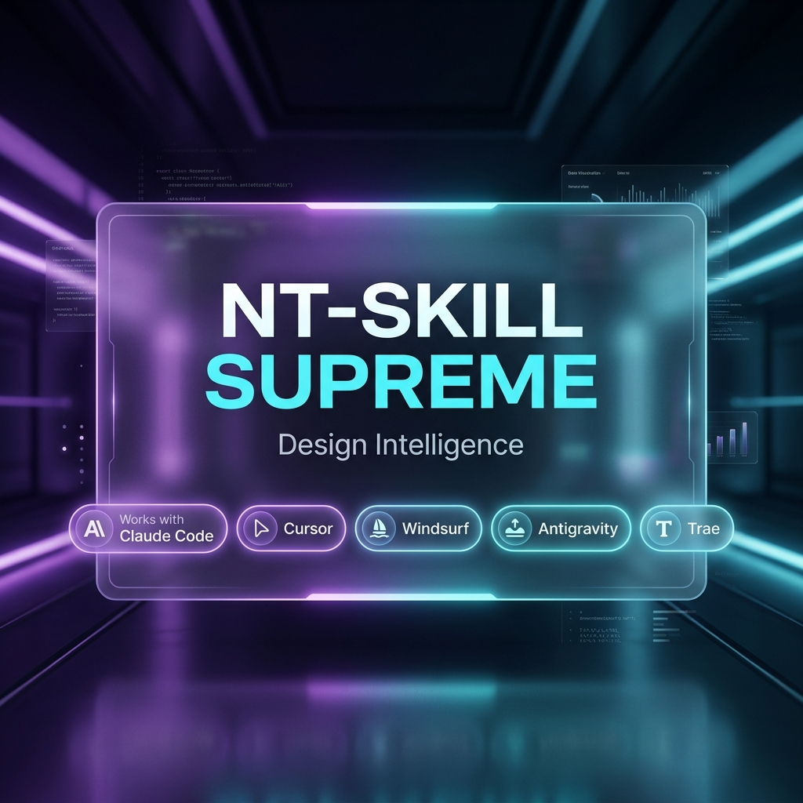

# 👑 NT-SKILL SUPREME

<p align="center">
  <b>es Español</b> | <a href="./README.md">us English</a>
</p>

<p align="center">
  
  
  
  
  
  
</p>

<p align="center">
  <b>El Framework Maestro para IAs Agénticas que inyecta Zero-Dead-UI (cero botones decorativos, 100% lógica funcional real), reconocimiento autónomo de datos del proyecto, expansión inteligente de intención ("escribe menos, produce más"), arquitectura full-stack type-safe, seguridad OWASP y diseño de ultra-alta fidelidad.</b>
</p>

<p align="center">
  <a href="./demo/index.html"><b>🌟 Ver Demostración Interactiva (DentalCare Pro)</b></a>
</p>

<p align="center">
  
</p>

---

## ⚡ Instalación Segura Multi-IA por CLI

Instala **NT-SKILL SUPREME** de forma segura en tus asistentes de IA mediante nuestro instalador CLI atómico basado en manifiesto:

### 🌟 Detección Automática Universal (Opción Segura Predeterminada)
Escanea automáticamente tu sistema en busca de entornos de IA activos e instala únicamente en las plataformas detectadas:
```bash
npx nt-skill-supreme init
```

### 🎯 Comandos Específicos por Plataforma

| Asistente de IA | Comando de Instalación Rápida | Ruta de Destino |
|---|---|---|
| **Google Gemini Antigravity** | `npx nt-skill-supreme init --ai antigravity` | `~/.gemini/config/skills/nt-skill-supreme` |
| **Claude Code & Desktop** | `npx nt-skill-supreme init --ai claude` | `~/.claude/skills/nt-skill-supreme` |
| **Cursor Editor** | `npx nt-skill-supreme init --ai cursor` | `.cursor/rules/nt-skill-supreme.mdc` |
| **Windsurf IDE** | `npx nt-skill-supreme init --ai windsurf` | `.windsurfrules` |
| **Trae IDE** | `npx nt-skill-supreme init --ai trae` | `AGENTS.md` |
| **Codex CLI** | `npx nt-skill-supreme init --ai codex` | `.codex/rules/AGENTS.md` |
| **OpenCode** | `npx nt-skill-supreme init --ai opencode` | `AGENTS.md` |

### 🛡️ Banderas de Seguridad y Gestión
- **Modo Simulación Dry-Run** (no modifica archivos en disco):  
  `npx nt-skill-supreme init --dry-run`
- **Reemplazo Seguro con Copia de Seguridad Automática** (`.bak.[timestamp]`):  
  `npx nt-skill-supreme init --force`
- **Inspección de Manifiesto de Instalación**:  
  `npx nt-skill-supreme status`
- **Desinstalación Atómica por Manifiesto**:  
  `npx nt-skill-supreme remove`

---

## 💥 La Diferencia Real: Antes vs Después (v4.0)

¿Por qué las aplicaciones generadas con **NT-SKILL SUPREME v4.0** superan radicalmente las limitaciones de las IAs básicas?

| Característica | ❌ Sin Skill (Generación IA Básica) | 🚀 Con NT-SKILL SUPREME v4.0 |
|---|---|---|
| **Interactividad y Botones** | Botones cosméticos sin acción (`onClick={() => console.log()}` o `#`) | **Zero-Dead-UI**: Ciclo completo de 4 estados (`idle`, `pending`, `success`, `error`), prevención de doble submit, spinners y mutaciones reales |
| **Datos del Proyecto** | Inventa mocks estáticos aislados sin conexión con el backend | **Reconocimiento Autónomo**: Inspecciona previamente esquemas ORM (Prisma/Drizzle/Supabase), tipos y stores existentes para enlazar datos reales |
| **Esfuerzo del Usuario** | Exige prompts larguísimos detallando cada estado, tipo y validación | **Smart Intent Expansion**: Con prompts breves de 5-10 palabras la IA deduce toda la arquitectura, edge cases, toasts y accesibilidad |
| **Formularios y Validación** | Formularios que no envían nada o no validan campos | Validación Zod en tiempo real, accesibilidad ARIA, spinners de envío y feedback del servidor |
| **Tablas y Listas** | Tablas muertas sin filtros ni acciones | Tablas de datos vivas con búsqueda reactiva, ordenamiento, estado vacío y exportación a CSV |
| **Arquitectura y Estado** | Mezcla estado de API en stores globales a ciegas | Separa estrictamente Server State (TanStack Query) y Client UI State con rollback optimista |
| **Seguridad OWASP** | Vulnerable a SQLi, XSS y rutas no autenticadas | Defensas OWASP, sanitización, headers CSP y cookies HttpOnly |
| **Testing y Calidad** | Borra o ignora tests que fallan para simular éxito | Verificación Test-Driven obligatoria (Vitest / Playwright 100% pass) |

---

## 🎨 Perfiles Visuales Contextuales

Adapta la intensidad del diseño dinámicamente según el tipo de proyecto:

- **`minimal`**: Elegancia editorial, enfoque en tipografía, ritmo de espacios, movimiento discreto, cero elementos recargados. *(Ideal para marcas de lujo, firmas legales, blogs y portafolios ejecutivos).*
- **`balanced`** *(Predeterminado)*: Estética premium, micro-interacciones táctiles, profundidad moderada, contraste WCAG AA, animaciones fluidas. *(Ideal para SaaS, webs de agencias, clínicas y servicios locales).*
- **`supreme`**: Alto impacto visual, inclinación 3D tilt al hover, seguimiento de spotlight, animaciones nativas de scroll y profundidad parallax. *(Ideal para lanzamientos de producto, experiencias web y showcases tecnológicos).*

---

## 🛠 Comandos Directos para Tu Agilidad Comercial

| Comando | Acción y Resultado |
|---|---|
| `/build-fullstack-app [nicho] [stack]` | **Motor Full-Stack**: Genera la arquitectura completa de una aplicación (Auth, DB schema, Zod API routes, Stripe, Admin UI). |
| `/build-client-site [nicho] [--style minimal\|balanced\|supreme]` | **Motor para Agencias**: Genera una web comercial completa en 1 solo archivo HTML/CSS/JS (Odontología, Gimnasio, Abogados, Restaurantes, Agencias, SaaS). |
| `/refactor-codebase` | Audita y reestructura el código existente aplicando principios SOLID, estándares de type-safety y arquitectura limpia. |
| `/security-audit` | Analiza el código buscando vulnerabilidades OWASP Top 10, fallas de sanitización, falta de rate-limiting y fugas de llaves secretas. |
| `/add-feature [tipo]` | Inyecta módulos full-stack con cableado real (Autenticación Supabase/Auth0, Pagos Stripe, Panel Admin, Upload a S3/R2). |
| `/add-section [tipo]` | Inyecta secciones de producción con lógica funcional (Header Pegajoso, Hero con Prueba Social, Switch de Precios, Lead Form con Zod). |
| `/rapid-localize` | Reemplaza placeholders con la marca, teléfono, WhatsApp y dirección del cliente en segundos. |
| `/design-audit` | Audita la web para corregir contrastes, eliminar Slop de IA, verificar accesibilidad y asegurar estados interactivos. |
| `/polish-ui [--style minimal\|balanced\|supreme]` | Eleva el diseño aplicando sombras flotantes, desenfoques glassmorphic y fuentes tipográficas según el perfil seleccionado. |

---

## 📁 Estructura del Repositorio

```
nt-skill-supreme/
├── assets/
│   └── banner.png                    # Imagen Banner Oficial Showcase
├── tests/
│   └── cli.test.js                   # Suite de Pruebas Automatizadas CLI (node --test)
├── SKILL.md                          # Definición Maestra de la Skill (Instrucciones de la IA)
├── AGENTS.md                         # Reglas del Sistema para Cursor, Trae, Windsurf, OpenCode, Codex y Antigravity
├── AUDIT.md                          # Auditoría Completa y Evaluación de Arquitectura
├── CHANGELOG.md                      # Historial de Cambios (Versión Semántica 4.0.0)
├── references/                       # Manuales Técnicos de Referencia
│   ├── functional-logic-and-wiring.md# [v4.0] Cero botones muertos, mutaciones asíncronas, prospección de datos
│   ├── component-blueprints.md       # [v4.0] Blueprints interactivos (Botón asíncrono, Zod form, Living Table, Cart)
│   ├── state-and-data-fetching.md    # [v4.0] Detección de stores, TanStack Query, Zustand, rollback optimista
│   ├── api-and-db-contracts.md       # [v4.0] Schema-to-UI Auto-Projection, validación Zod, Drizzle/Prisma, RLS
│   ├── auth-and-multi-tenancy.md     # OAuth, Passkeys, cookies de sesión, middleware multi-tenant, RBAC
│   ├── testing-and-qa.md             # Vitest, Playwright E2E, directiva de verificación IA, anti-regresión
│   ├── security-and-hardening.md     # Defensas OWASP, sanitización, rate-limiting, headers CSP
│   ├── fullstack-scaffolding.md      # Arquitectura de carpetas, webhooks de Stripe, upload Cloud storage
│   ├── niche-blueprints.md           # Planos de estructura comercial por industria
│   ├── cro-and-performance.md        # Psicología de conversión en 3s y velocidad web
│   ├── motion-and-physics.md         # Animaciones CSS de scroll, Inclinación 3D e interacciones
│   ├── image-gen-and-fallbacks.md    # Generación de imágenes por IA y fallbacks Unsplash/SVG
│   ├── taste-anti-slop.md            # Reglas anti-plantillas genéricas y paletas HSL
│   ├── ui-ux-wcag.md                 # Cuadrículas de 8px y accesibilidad WCAG 2.1 AA
│   └── craft-and-polish.md           # Protocolo de auditoría visual de diseño
├── bin/cli.js                        # Script de instalación Multi-IA por terminal
└── .claude-plugin/plugin.json        # Configuración para Claude Code y Claude Desktop
```

---

## 🧪 Pruebas Automatizadas

Ejecuta la suite de pruebas localmente:
```bash
npm test
```

Verifica la interfaz CLI:
```bash
npm run lint
```

---

## 📄 Licencia
Publicado bajo la [Licencia MIT](LICENSE). Copyright (c) 2026 NachoTorresRD.
