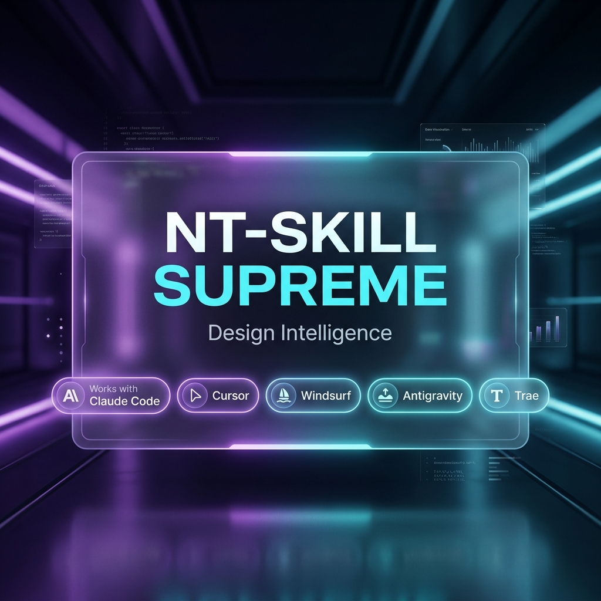

# 👑 NT-SKILL SUPREME

<p align="center">
  <a href="./README.es.md">es Español</a> | <b>us English</b>
</p>

<p align="center">
  
  
  
  
  
  
</p>

<p align="center">
  <b>The Master Next-Gen Agentic AI Engineering Framework enforcing Zero-Dead-UI (zero cosmetic buttons, 100% working operational logic), autonomous project data discovery, smart intent expansion (write less, ship complete features), type-safe full-stack architecture, OWASP security, and ultra-high craft design.</b>
</p>

<p align="center">
  <a href="./demo/index.html"><b>🌟 View Interactive Demo (DentalCare Pro)</b></a>
</p>

<p align="center">
  
</p>

---

## ⚡ Multi-AI Safe CLI Installation

Install **NT-SKILL SUPREME** safely across all your AI assistants using our atomic, manifest-driven CLI installer:

### 🌟 Universal Auto-Detection (Safe Default)
Automatically scans your system for active AI environment signatures and installs only to detected platforms:
```bash
npx nt-skill-supreme init
```

### 🎯 Targeted Platform Commands

| Target AI Assistant | Terminal Command | Installation Route |
|---|---|---|
| **Google Gemini Antigravity** | `npx nt-skill-supreme init --ai antigravity` | `~/.gemini/config/skills/nt-skill-supreme` |
| **Claude Code & Desktop** | `npx nt-skill-supreme init --ai claude` | `~/.claude/skills/nt-skill-supreme` |
| **Cursor Editor** | `npx nt-skill-supreme init --ai cursor` | `.cursor/rules/nt-skill-supreme.mdc` |
| **Windsurf IDE** | `npx nt-skill-supreme init --ai windsurf` | `.windsurfrules` |
| **Trae IDE** | `npx nt-skill-supreme init --ai trae` | `AGENTS.md` |
| **Codex CLI** | `npx nt-skill-supreme init --ai codex` | `.codex/rules/AGENTS.md` |
| **OpenCode** | `npx nt-skill-supreme init --ai opencode` | `AGENTS.md` |

### 🛡️ Safety Flags & Management Commands
- **Dry Run Simulation** (modifies zero disk files):  
  `npx nt-skill-supreme init --dry-run`
- **Safe Overwrite with Automatic Backups** (`.bak.[timestamp]`):  
  `npx nt-skill-supreme init --force`
- **Inspect Installation Manifest**:  
  `npx nt-skill-supreme status`
- **Atomic Manifest-Driven Uninstall**:  
  `npx nt-skill-supreme remove`

---

## 💥 The Real Transformation: Before vs After (v4.0)

Why do applications and websites generated with **NT-SKILL SUPREME v4.0** dramatically outperform standard AI code generations?

| Feature | ❌ Without Skill (Basic AI Era) | 🚀 With NT-SKILL SUPREME v4.0 |
|---|---|---|
| **Interactivity & Buttons** | Cosmetic buttons with no real action (`onClick={() => console.log()}` or `#`) | **Zero-Dead-UI**: Full 4-state lifecycle (`idle`, `pending`, `success`, `error`), double-click guard, spinners & real mutations |
| **Project Data Integration** | Fabricates disconnected mock arrays with no backend linkage | **Autonomous Data Discovery**: Proactively discovers and binds existing ORM schemas (Prisma/Drizzle/Supabase), types, and stores |
| **Developer Effort** | Demands paragraphs of prompting for every state, edge case, and validation | **Smart Intent Expansion**: 5-10 word prompts are expanded into complete vertical slices with validation, error boundaries, and full logic |
| **Forms & Validation** | Submits into a void or lacks field validation | Real-time Zod validation, ARIA accessibility, submit spinners, and server response banners |
| **Tables & Data Grids** | Static tables without filtering or actions | Living data tables with reactive search, column sorting, empty state recovery, and CSV export |
| **Architecture & State** | Mixes API state in global stores blindly | Strictly separates Server State (TanStack Query) & Client UI State with optimistic rollback |
| **Security & OWASP** | Vulnerable to SQLi, XSS, and unauthenticated routes | OWASP defenses, DOMPurify HTML sanitization, CSP headers, HttpOnly cookies |
| **Testing & Quality** | Mutes or deletes failing tests to pretend success | Mandatory Test-Driven AI Verification (Vitest / Playwright 100% pass) |

---

## 🎨 Contextual Visual Profiles

Adapt design intensity dynamically to match project objectives:

- **`minimal`**: Refined, editorial cleanliness, typography cadence, whitespace rhythm, subtle motion, zero neon/glow clutter. *(Ideal for luxury, legal, blogs, executive portfolios).*
- **`balanced`** *(Default)*: Premium aesthetic, tactile micro-interactions, moderate depth, WCAG AA contrast, smooth spring physics. *(Ideal for SaaS, agency sites, clinics, local services).*
- **`supreme`**: High visual impact, 3D perspective hover tilt, spotlight tracking, native scroll-driven animations, parallax depth. *(Ideal for product launches, web experiences, tech portfolios).*

---

## 🛠 Direct Commands & Agency Workflows

| Command | Action |
|---|---|
| `/build-fullstack-app [niche] [stack]` | **Full-Stack Production Engine**: Generates a complete full-stack web application structure (Auth, DB schema, Zod API routes, Stripe, Admin UI). |
| `/build-client-site [niche] [--style minimal\|balanced\|supreme]` | **Rapid Agency Engine**: Generates a complete, multi-section client site in a single HTML file (Dental, Gym, Law, Restaurant, Agency, SaaS). |
| `/refactor-codebase` | Audits and restructures existing codebases following SOLID principles, type-safety standards, and clean architecture. |
| `/security-audit` | Analyzes code for OWASP Top 10 vulnerabilities, input sanitization gaps, rate-limiting deficits, and secret exposures. |
| `/add-feature [type]` | Injects full-stack feature modules with real functional wiring (Auth Auth0/Supabase, Stripe Billing, User Admin Panel, S3/R2 Uploads). |
| `/add-section [type]` | Injects a production-ready UI section with working logic (Sticky Header, Floating WhatsApp, Pricing Switch, Accordion FAQ, Zod Lead Form). |
| `/rapid-localize` | Replaces placeholders with client-specific brand name, phone number, WhatsApp link, and local address. |
| `/design-audit` | Audits current frontend code for slop, contrast balance, spacing cadence, WCAG AA compliance, and interaction states. |
| `/polish-ui [--style minimal\|balanced\|supreme]` | Elevates existing UI with smooth animations, elevated depth, modern font stacks, and glassmorphism appropriate to the selected profile. |

---

## 📁 Repository Directory Structure

```
nt-skill-supreme/
├── assets/
│   └── banner.png                    # Official Showcase Banner Asset
├── tests/
│   └── cli.test.js                   # CLI Automated Test Suite (node --test)
├── SKILL.md                          # Master AI Skill Definition (Agent Instructions)
├── AGENTS.md                         # System Rules for Cursor, Trae, Windsurf, OpenCode, Codex & Antigravity
├── AUDIT.md                          # Complete Repository Audit & Architecture Evolution
├── CHANGELOG.md                      # Release History (Semantic Version 4.0.0)
├── references/                       # Master Technical Reference Modules
│   ├── functional-logic-and-wiring.md# [v4.0] Zero-Dead-UI, async mutations, project data discovery
│   ├── component-blueprints.md       # [v4.0] Interactive blueprints (Async button, Zod form, Living Table, Cart)
│   ├── state-and-data-fetching.md    # [v4.0] Store discovery, TanStack Query, Zustand, optimistic rollback
│   ├── api-and-db-contracts.md       # [v4.0] Schema-to-UI Auto-Projection, Zod validation, Drizzle/Prisma, RLS
│   ├── auth-and-multi-tenancy.md     # OAuth, Passkeys, session cookies, multi-tenant middleware, RBAC
│   ├── testing-and-qa.md             # Vitest, Playwright E2E, AI test verification, anti-regression
│   ├── security-and-hardening.md     # OWASP defenses, sanitization, rate-limiting, CSP headers
│   ├── fullstack-scaffolding.md      # Directory layout, Stripe webhooks, Cloud storage uploads
│   ├── niche-blueprints.md           # Industry-specific client website blueprints
│   ├── cro-and-performance.md        # 3-Second value rule, mobile ergonomics, performance standards
│   ├── motion-and-physics.md         # Scroll-driven CSS animations, 3D card tilt, spotlight tracking
│   ├── image-gen-and-fallbacks.md    # Dynamic AI image generation & graceful fallback strategy
│   ├── taste-anti-slop.md            # Aesthetic guidelines, anti-slop rules, tailored palettes
│   ├── ui-ux-wcag.md                 # 8px spatial grid, layout rules, WCAG 2.1 AA checklist
│   └── craft-and-polish.md           # Visual QA audit protocols, micro-typography (`tabular-nums`)
├── bin/cli.js                        # Multi-AI safe installation CLI script
└── .claude-plugin/plugin.json        # Claude Code & Desktop Plugin manifest
```

---

## 🧪 Automated Testing

Run the automated test suite locally:
```bash
npm test
```

Verify CLI linting & command surface:
```bash
npm run lint
```

---

## 📄 License
Released under the [MIT License](LICENSE). Copyright (c) 2026 NachoTorresRD.
